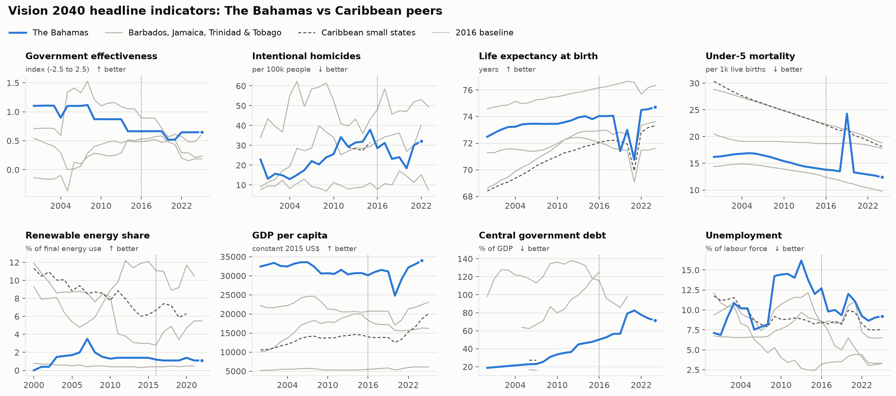
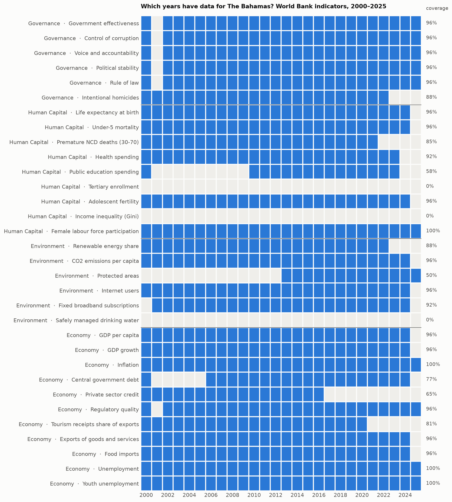

# Vision 2040 Indicator Tracker: The Bahamas

A small monitoring-and-evaluation project. It tracks The Bahamas' progress on the four pillars of
[Vision 2040, the National Development Plan](https://observatorioplanificacion.cepal.org/en/plans/vision-2040-national-development-plan-bahamas),
using open World Bank data, and asks three questions:

1. **Can we measure it?** For each indicator, how complete and how current is the Bahamas data?
2. **Is it moving the right way?** Value at the 2016 baseline (when Vision 2040 planning began) against the latest
   value, plus a statistical test of the trend since 2010.
3. **How do we compare?** The Bahamas against Barbados, Jamaica, Trinidad and Tobago and the Caribbean
   small states aggregate.

The plan's [2nd Working Draft (2017)](https://cepei.org/wp-content/uploads/2019/10/Vision-2040-National-Development-Plan-of-the-Bahamas.pdf)
sets out 16 goals and, in Part D, proposes outcome indicators for each one. Most of those have no baseline
or target yet, and no monitoring framework has been formally adopted. This project tests what can be tracked
today from open international data: 32 World Bank indicators, each mapped to a pillar and one of the 16 goals
(`config/goals.csv`). The data-availability audit matters as much as the trends: an indicator with no recent
data can't be monitored.





## Results

<!-- RESULTS:START -->
_Generated from World Bank data downloaded on 2026-11-16. Baseline = nearest year to 2016. Re-run `python run_pipeline.py` to refresh._

### Key findings

- **Data availability.** 29 of 32 indicators have any Bahamas data since 2000. On average The Bahamas has a value for 82% of years, against 82% for Barbados, Jamaica and Trinidad and Tobago.

- **Goal coverage.** 12 of the plan's 16 goals have at least one indicator. Not yet covered: Goal 4 (administration of justice); Goal 8 (land administration); Goal 10 (interconnected transport); Goal 16 (culture). International data here is thin, so these will mostly need national sources.

- **Gaps that would block monitoring** (no data, sparse, or more than 3 years old): Intentional homicides (Out of date, latest 2022); Premature NCD deaths (30-70) (Out of date, latest 2021); Tertiary enrollment (No Bahamas data); Income inequality (Gini) (No Bahamas data); Renewable energy share (Out of date, latest 2022); Safely managed drinking water (No Bahamas data); Private sector credit (Out of date, latest 2016); Tourism receipts share of exports (Out of date, latest 2020).

- **Direction of travel since 2010** (linear trend, 95% confidence): 7 improving, 7 worsening, 8 no clear trend, 8 out of date. The trend uses every year since 2010, so it can differ from the 2016-to-latest change shown in brackets.

- **Improving:** Public education spending (2.59 in 2016 → 2.74 in 2023); Adolescent fertility (29.0 in 2016 → 24.5 in 2024); Protected areas (1.20 in 2016 → 8.30 in 2025); Internet users (80.0 in 2016 → 92.5 in 2024); Fixed broadband subscriptions (21.9 in 2016 → 25.3 in 2024); Unemployment (12.7 in 2016 → 9.21 in 2025); Youth unemployment (25.8 in 2016 → 19.2 in 2025).

- **Worsening:** Government effectiveness (0.66 in 2016 → 0.65 in 2025); Control of corruption (1.09 in 2016 → 1.04 in 2025); Voice and accountability (0.59 in 2016 → 0.63 in 2025); Rule of law (0.40 in 2016 → 0.23 in 2025); CO2 emissions per capita (3.21 in 2016 → 3.64 in 2024); Central government debt (50.2 in 2016 → 71.5 in 2024); Regulatory quality (0.20 in 2016 → -0.09 in 2025).

- **Ahead of all three peers:** Government effectiveness (2025), Adolescent fertility (2024), Female labour force participation (2025), Protected areas (2025), Internet users (2024), GDP per capita (2024), GDP growth (2024).

- **Behind all three peers:** Premature NCD deaths (30-70) (2021), Public education spending (2023), Unemployment (2025), Youth unemployment (2025).

### Indicator scorecard

| Pillar | Indicator | Baseline | Latest | Trend since 2010 | Rank vs 3 peers |
|---|---|---|---|---|---|
| Governance | Government effectiveness <sub>index (-2.5 to 2.5)</sub> | 0.66 (2016) | 0.65 (2025) | Worsening (-0.02/yr, p=0.001) | 1 of 4 (2025) |
| Governance | Control of corruption <sub>index (-2.5 to 2.5)</sub> | 1.09 (2016) | 1.04 (2025) | Worsening (-0.02/yr, p=0.007) | 2 of 4 (2025) |
| Governance | Voice and accountability <sub>index (-2.5 to 2.5)</sub> | 0.59 (2016) | 0.63 (2025) | Worsening (-0.02/yr, p=0.001) | 2 of 4 (2025) |
| Governance | Political stability <sub>index (-2.5 to 2.5)</sub> | 0.80 (2016) | 1.02 (2025) | No clear trend (0.00/yr, p=0.718) | 2 of 4 (2025) |
| Governance | Rule of law <sub>index (-2.5 to 2.5)</sub> | 0.40 (2016) | 0.23 (2025) | Worsening (-0.04/yr, p=0.000) | 2 of 4 (2025) |
| Governance | Intentional homicides <sub>per 100k people</sub> | 28.6 (2016) | 32.2 (2022) | Out of date | 2 of 4 (2022) |
| Human Capital | Life expectancy at birth <sub>years</sub> | 74.0 (2016) | 74.7 (2024) | No clear trend (-0.01/yr, p=0.920) | 2 of 4 (2024) |
| Human Capital | Under-5 mortality <sub>per 1k live births</sub> | 13.8 (2016) | 12.4 (2024) | No clear trend (-0.11/yr, p=0.522) | 2 of 4 (2024) |
| Human Capital | Premature NCD deaths (30-70) <sub>% probability of dying</sub> | 20.5 (2016) | 20.4 (2021) | Out of date | 4 of 4 (2021) |
| Human Capital | Health spending <sub>% of GDP</sub> | 5.66 (2016) | 6.30 (2023) | Context only | – |
| Human Capital | Public education spending <sub>% of GDP</sub> | 2.59 (2016) | 2.74 (2023) | Improving (0.06/yr, p=0.023) | 4 of 4 (2023) |
| Human Capital | Tertiary enrollment <sub>% gross</sub> | – | No data | Out of date | – |
| Human Capital | Adolescent fertility <sub>births per 1k women 15-19</sub> | 29.0 (2016) | 24.5 (2024) | Improving (-1.04/yr, p=0.000) | 1 of 4 (2024) |
| Human Capital | Income inequality (Gini) <sub>index (0-100)</sub> | – | No data | Out of date | – |
| Human Capital | Female labour force participation <sub>% of women 15+</sub> | 70.5 (2016) | 70.7 (2025) | No clear trend (0.02/yr, p=0.846) | 1 of 4 (2025) |
| Environment | Renewable energy share <sub>% of final energy use</sub> | 1.20 (2016) | 1.10 (2022) | Out of date | 3 of 4 (2021) |
| Environment | CO2 emissions per capita <sub>t CO2e per person</sub> | 3.21 (2016) | 3.64 (2024) | Worsening (0.06/yr, p=0.008) | 3 of 4 (2024) |
| Environment | Protected areas <sub>% of territory</sub> | 1.20 (2016) | 8.30 (2025) | Improving (0.76/yr, p=0.001) | 1 of 4 (2025) |
| Environment | Internet users <sub>% of population</sub> | 80.0 (2016) | 92.5 (2024) | Improving (2.75/yr, p=0.000) | 1 of 4 (2024) |
| Environment | Fixed broadband subscriptions <sub>per 100 people</sub> | 21.9 (2016) | 25.3 (2024) | Improving (0.92/yr, p=0.003) | 3 of 4 (2022) |
| Environment | Safely managed drinking water <sub>% of population</sub> | – | No data | Out of date | – |
| Economy | GDP per capita <sub>constant 2015 US$</sub> | 30,152 (2016) | 33,968 (2024) | No clear trend (75.0/yr, p=0.556) | 1 of 4 (2024) |
| Economy | GDP growth <sub>annual %</sub> | -1.16 (2016) | 3.38 (2024) | No clear trend (0.27/yr, p=0.587) | 1 of 4 (2024) |
| Economy | Inflation <sub>annual %</sub> | -0.35 (2016) | 1.11 (2025) | No clear trend (0.04/yr, p=0.644) | 3 of 4 (2025) |
| Economy | Central government debt <sub>% of GDP</sub> | 50.2 (2016) | 71.5 (2024) | Worsening (3.48/yr, p=0.000) | 2 of 4 (2007) |
| Economy | Private sector credit <sub>% of GDP</sub> | 51.9 (2016) | 51.9 (2016) | Out of date | 2 of 4 (2016) |
| Economy | Regulatory quality <sub>index (-2.5 to 2.5)</sub> | 0.20 (2016) | -0.09 (2025) | Worsening (-0.05/yr, p=0.000) | 3 of 4 (2025) |
| Economy | Tourism receipts share of exports <sub>% of exports</sub> | 79.6 (2016) | 59.6 (2020) | Out of date | – |
| Economy | Exports of goods and services <sub>% of GDP</sub> | 32.9 (2016) | 37.8 (2024) | No clear trend (-0.26/yr, p=0.344) | – |
| Economy | Food imports <sub>% of merchandise imports</sub> | 20.2 (2016) | 20.0 (2024) | Context only | – |
| Economy | Unemployment <sub>% of labour force</sub> | 12.7 (2016) | 9.21 (2025) | Improving (-0.44/yr, p=0.000) | 4 of 4 (2025) |
| Economy | Youth unemployment <sub>% of ages 15-24</sub> | 25.8 (2016) | 19.2 (2025) | Improving (-0.85/yr, p=0.000) | 4 of 4 (2025) |
<!-- RESULTS:END -->

## Method

| Step | What it does |
|---|---|
| **Indicator framework** | `config/indicators.csv` maps 32 World Bank indicators to the Vision 2040 pillars (Governance, Human Capital, Environment, Economy) and goals, with the desired direction for each (higher or lower is better). Health spending and tourism's share of exports are tracked as context, with no target direction. |
| **Data collection** | `src/fetch.py` calls the [World Bank API](https://datahelpdesk.worldbank.org/knowledgebase/articles/889392) for The Bahamas, three peers and the Caribbean small states aggregate, 2000 to today. Raw responses are cached in `data/raw/` for reproducibility. Indicators the API doesn't return are logged, not dropped. |
| **Data audit** | Share of years with a value, first and latest year, and a gap flag: *no data*, *out of date* (latest value more than 3 years old) or *sparse* (under 50% of years). |
| **Baseline vs latest** | Baseline is the observation nearest to 2016, within ±2 years. |
| **Trend test** | OLS regression of value on year, 2010 onward, with at least 6 observations. A trend counts as *improving* or *worsening* only when the slope's p-value is below 0.05. Otherwise it is *no clear trend*. Indicators the audit flags as out of date or missing are labelled *out of date* and get no trend label. |
| **Peer comparison** | The Bahamas is ranked against Barbados, Jamaica and Trinidad and Tobago in the latest year all four have data (1 = best). That year is shown next to each rank. |

## Limitations

- **Simple trend model.** A straight-line trend on annual data is a screening tool, not a forecast. Shocks such
  as COVID-19 in 2020 and Hurricane Dorian in 2019 pull the slope around. Annual series are also often
  autocorrelated, which makes the p-values optimistic.
- **Ranks can lag.** Ranks use the latest year all four countries have data, so one country's late
  reporting can push the comparison back several years. The year is shown with each rank.
- **The Caribbean small states line is context, not a peer average.** It is the World Bank's
  [12-country group](https://data.worldbank.org/region/caribbean-small-states), which *includes* The Bahamas
  (pulling the line toward it) and *excludes* Jamaica. Most series are weighted averages, a few are medians,
  and the World Bank publishes no group figure for the governance indicators or for years when too few members
  report. It appears in the charts and scorecard only and never affects the ranks.
- **Proposed indicators, not official ones.** These are World Bank series chosen to fit the plan's goals,
  not the plan's own Part D indicators or an adopted Vision 2040 results framework. Many Part D indicators
  (SDG survey measures, administrative counts) have no international series. National sources such as the
  [Bahamas National Statistical Institute](https://www.bahamas.gov.bs/statistics) may hold more recent
  figures.
- **Possible code changes.** The governance indicators come from the Worldwide Governance Indicators
  (World Bank source 3). If the API stops returning them, the audit shows it.

## Run it

```bash
python -m venv .venv && source .venv/bin/activate
pip install -r requirements.txt
python -m ipykernel install --user --name bahamas-vision2040 --display-name "Python (bahamas-vision2040)"
python run_pipeline.py          # fetch, analyse, chart, and rewrite the Results section
jupyter notebook notebooks/vision2040_indicators.ipynb   # walkthrough
```

To add an indicator, add a row to `config/indicators.csv` with its
[World Bank code](https://data.worldbank.org/indicator). To change the comparison countries, edit
`config/countries.csv`.

## Project structure

```
config/        indicator framework and countries
src/fetch.py   World Bank API client with caching
src/analysis.py  coverage audit, baseline vs latest, OLS trend tests, peer ranks
src/charts.py  figures
src/report.py  writes the Results section of this README
notebooks/     step-by-step walkthrough
outputs/       scorecard and audit CSVs, figures
```

**Data:** World Bank, World Development Indicators and Worldwide Governance Indicators (CC BY 4.0).
**Author:** Jyles Romer
